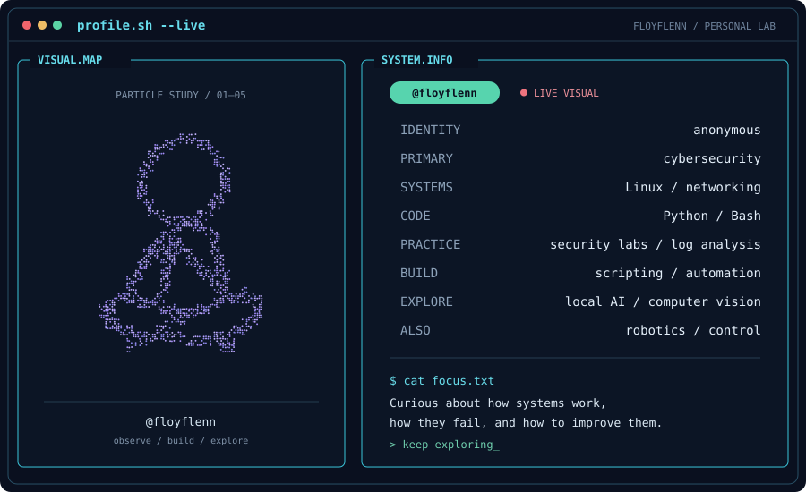

---

### `~/about`

I'm **floyflenn**. I explore how systems work, investigate how they fail, and build tools to understand them better.

### `~/interests`

**`01` Security & systems**  
Cybersecurity, Linux, networking, hands-on labs and log analysis.

**`02` Code & automation**  
Python, Bash and practical scripts that turn ideas into useful tools.

**`03` Experiments**  
Local AI, computer vision, robotics and control.

### `~/toolbox`

`Python` · `Bash` · `Linux` · `Git` · `VS Code` · `RTDE`

---

**[Explore my repositories ↗](https://github.com/floyflenn?tab=repositories)**

Stay curious. Build what’s missing. — <strong>floyflenn</strong>
