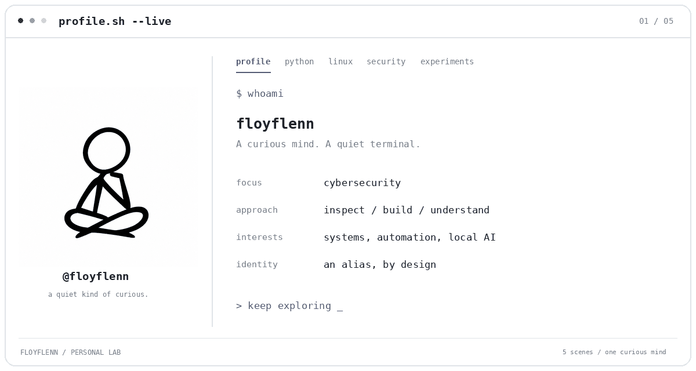

<picture>
  <source media="(prefers-reduced-motion: reduce) and (max-width: 640px)" srcset="assets/terminal/profile-mobile.png">
  <source media="(prefers-reduced-motion: reduce)" srcset="assets/terminal/profile.png">
  <source media="(max-width: 640px)" srcset="assets/terminal/profile-mobile.gif">
  
</picture>

Curious about systems, how they work, and how they fail. Building small tools and following interesting questions.

**Cybersecurity · Python · Linux · Automation · Experiments**

Explore the five scenes without animation

- [Profile](assets/terminal/profile.png) — a curious mind and a quiet terminal.
- [Python](assets/terminal/python.png) — automation, useful scripts, and readable code.
- [Linux](assets/terminal/linux.png) — shells, permissions, networking, and logs.
- [Security](assets/terminal/security.png) — investigate assumptions in authorized labs.
- [Experiments](assets/terminal/experiments.png) — local AI, computer vision, and robotics.

